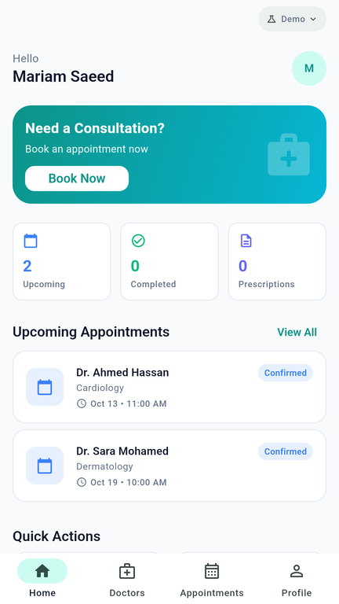
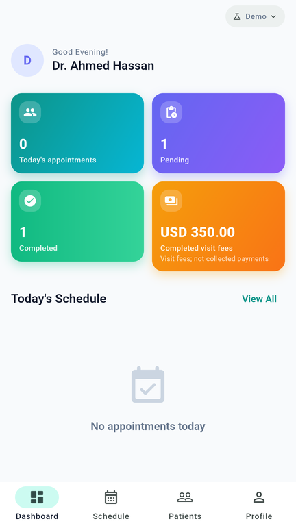
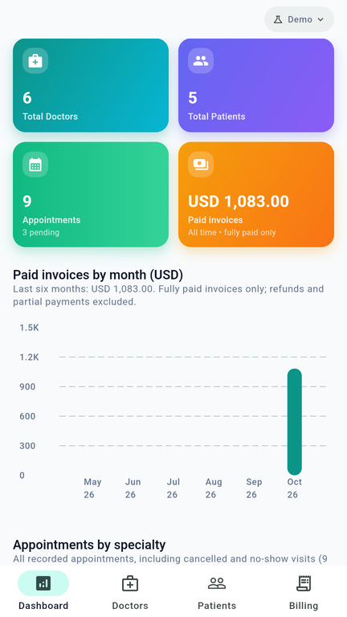

# MediFlow Pro

[](https://github.com/mmbayoumitaha/MediFlow-Pro-Smart-Clinic-Manager/actions/workflows/verify.yml)

A Flutter clinic manager connecting patient booking, doctor schedules and clinic administration. Explore all three roles with the built-in fictional clinic, or configure Firebase Auth and Firestore for a connected clinic.

## Clinic workflows

| Patient | Doctor | Administrator |
| --- | --- | --- |
| Search doctors and specialties | View schedule and associated patients | Manage doctors and patient profiles |
| Book available 30-minute visits | Confirm, start and complete visits | Manage appointments and unused accounts |
| Cancel upcoming visits | Edit profile and working periods | Issue consultation invoices |
| View personal appointments, prescriptions and invoices | Control availability for new bookings | Record settlements/refunds and view analytics |

Role-aware GoRouter navigation and scoped data keep each account in its own portal. Riverpod view models coordinate immutable state, errors, retries and account changes. The domain, data and presentation layers use repository contracts and injected clocks; [architecture](docs/ARCHITECTURE.md) explains the boundaries.

The interface uses Material 3, light/dark themes, bundled fonts and local specialty icons. UI copy is English. Charts use `fl_chart` and derive from clinic records.

## Screens

<table><tr>
<td></td>
<td></td>
<td></td>
</tr></table>

See the [demo walkthrough](docs/DEMO_WALKTHROUGH.md) for the booking and management sequence.

## Try the demo

Use **Flutter 3.47.4 / Dart 3.13.3**:

```bash
git clone https://github.com/mmbayoumitaha/MediFlow-Pro-Smart-Clinic-Manager.git
cd MediFlow-Pro-Smart-Clinic-Manager
flutter pub get --enforce-lockfile
flutter run -d chrome
```

Select Patient, Doctor or Admin and use the prefilled `demo@mediflow.com` / `password123`. Demo authentication accepts dummy passwords of at least six characters; use fictional details. Other demo emails retain their recorded role.

Demo data stays in memory across logout, so you can explore the same clinic from different roles. **Reset demo**, in the small Demo badge menu, asks for confirmation and restores the fictional clinic. Restart also clears changes; theme settings last for the running app. The default demo never initializes Firebase. Dependency installation requires internet access; the built application bundles its renderer and fonts. Serving its assets locally permits use without internet. Browser reload while completely disconnected from the asset server requires a separate caching/installation strategy; no service worker is supplied.

## Connected clinic

Firebase mode uses **email/password Auth + Standard Firestore** with Security Rules and atomic client transactions. It requires no Cloud Functions, Storage or billing upgrade. Spark quotas still apply. See [setup and emulator commands](docs/FIREBASE.md) and [transaction contracts](docs/SPARK_MIGRATION.md).

```bash
cp config/firebase.example.json config/firebase.local.json
# Fill in your registered Firebase app's client options.
flutter run -d chrome --dart-define-from-file=config/firebase.local.json
```

Patients self-register; trusted administrators bind existing doctor Auth identities. Roles come from server-confirmed profiles. Reservations, lifecycle updates and invoice changes are validated by rules against the actual identity and server time. Firestore disk persistence is disabled, and connected writes require a server connection.

## Development

```bash
dart run tool/check_architecture.dart
dart format --output=none --set-exit-if-changed lib test tool integration_test test_driver
flutter analyze --no-pub
flutter test --no-pub
flutter build web --release --no-pub
```

Tests cover business policies, Mockito repository interactions, account isolation, async/disposal races, time boundaries, analytics and responsive layouts. Separate Auth/Firestore emulator tests exercise security rules and Chromium workflows. GitHub Actions runs these checks on pushes and pull requests. [Development instructions](docs/DEVELOPMENT.md), [observed release checks](docs/RELEASE_CHECKS.md) and the [development history](docs/REPAIR_PLAN.md) distinguish compiled platforms from observed runtime journeys.

## Product conventions

- All amounts are USD. Revenue charts show fully settled, non-refunded invoice totals; completed-visit fees are a separate metric.
- Payment actions record status and never move real money. Prescription history is read-only. Uploads, notifications, prescription issuing and partial-payment ledgers are outside the current scope.
- Demo scheduling uses the device wall clock. Connected scheduling uses Africa/Cairo, a fixed half-hour grid and the next 14 dates, excluding today. Overnight periods are unavailable.
- Availability edits preserve existing visits. Connected working-hour edits require reserved visits to be finished or cancelled first.
- Deletion is limited to unused profiles. Connected deletion preserves Auth identities and email reservations to prevent re-enrollment under removed identities.

Licensed under [MIT](LICENSE). Bundled fonts retain their [Open Font Licenses](THIRD_PARTY_NOTICES.md).
